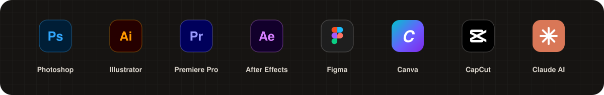

  
  
  
  

## About me

I'm **Siva Sundar Srisailapu**, a Graphic Designer & Video Editor from Visakhapatnam, India. I design posters, YouTube thumbnails and social media creatives, edit high-energy reels, and build clean website layouts. I'm also the founder of **Telugu Anime Database (TADB)**, a website, Android app and Instagram community for Telugu anime fans.

- 🎨 **Right now:** Graphic Designer & Video Editor at **SHM Technologies** (since Aug 2026)
- 🌸 **Building:** the website and app for **[Andhra Anime Club](https://andhra-anime-club.pages.dev/)**
- 📱 **Shipped:** the TADB Android app, with **1,000+ downloads** on Google Play
- 💬 **Ask me about:** Photoshop, thumbnails, reels, CapCut edits and Figma layouts

## Featured work

<table>
  <tr>
    <td width="50%"></td>
    <td width="50%"></td>
  </tr>
  <tr>
    <td width="50%"></td>
    <td width="50%"></td>
  </tr>
</table>

Open any folder on my <a href="https://sivasundarsrisailapu.github.io/siva-sundar-portfolio/#projects">portfolio</a> to see the full project files.

## Toolkit

  
  
  
  
  
  

## Journey

| | Role | Where | When |
|:-:|---|---|---|
| 💼 | Graphic Designer & Video Editor | SHM Technologies | Aug 2026 – Present |
| 🚀 | Founder & Content Creator | Telugu Anime Database (TADB) | 2024 – Present |
| 💼 | Associate, Data & Documentation | WNS (Capgemini) | 2025 |
| 💼 | Associate, Operations & Process Support | Tech Mahindra | 2024 |
| 🎓 | Bachelor of Arts (B.A.) | Undergraduate degree | 2025 – Present |
| 🎓 | Diploma, Mechanical Engineering | Sai Ganapathi Polytechnic, Visakhapatnam | 2017 – 2020 |

 

